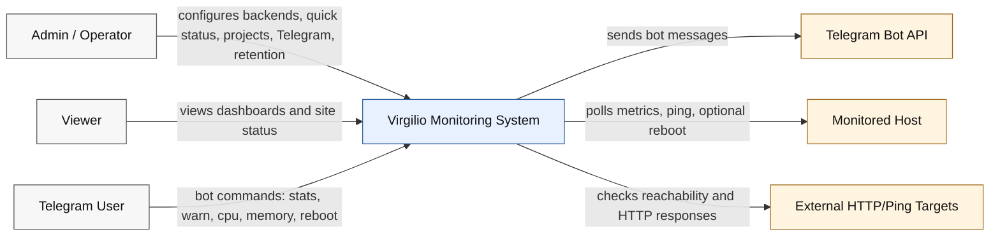
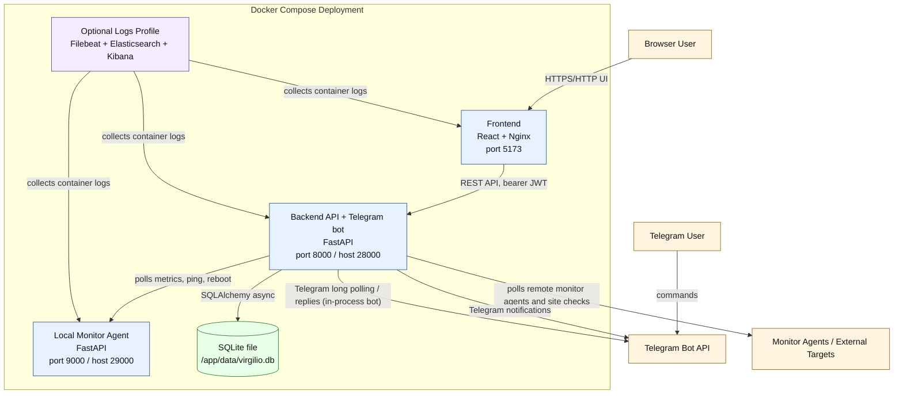

# Architecture

This folder documents the current Virgilio/server-monitor architecture from the codebase.

## Contents

- C4 system context diagram below.
- C4 container diagram below.
- [openapi-backend.yaml](openapi-backend.yaml): generated OpenAPI contract for `backend/app/main.py`.
- [openapi-monitor.yaml](openapi-monitor.yaml): generated OpenAPI contract for `monitor/app/main.py`.
- [database.md](database.md): database schemas, tables, relationships, retention notes, and Mermaid ER diagram.

## Runtime Summary

Virgilio is deployed as a Docker Compose stack with:

- React frontend served by Nginx.
- FastAPI backend for auth, dashboard data, admin configuration, metric history, notifications, and Telegram integration.
- FastAPI monitor agent for host metrics, ping checks, and optional host reboot.
- SQLite file (WAL mode) on a named volume for configuration and metric history.
- Optional Elasticsearch, Kibana, and Filebeat profile for container log collection.

The frontend calls the backend API. The backend polls monitor agents, ingests metric snapshots, executes quick-status checks, stores data in SQLite, and sends Telegram notifications when configured.

## C4 System Context



## C4 Container Diagram



## Regenerating OpenAPI

The OpenAPI files are generated directly from the FastAPI app objects:

```bash
.venv/bin/python - <<'PY'
from pathlib import Path
import yaml

from backend.app.main import app as backend_app
from monitor.app.main import app as monitor_app

out = Path("architecture")
for filename, app in (
    ("openapi-backend.yaml", backend_app),
    ("openapi-monitor.yaml", monitor_app),
):
    schema = app.openapi()
    with (out / filename).open("w", encoding="utf-8") as fh:
        yaml.safe_dump(schema, fh, sort_keys=False, allow_unicode=False)
PY
```
