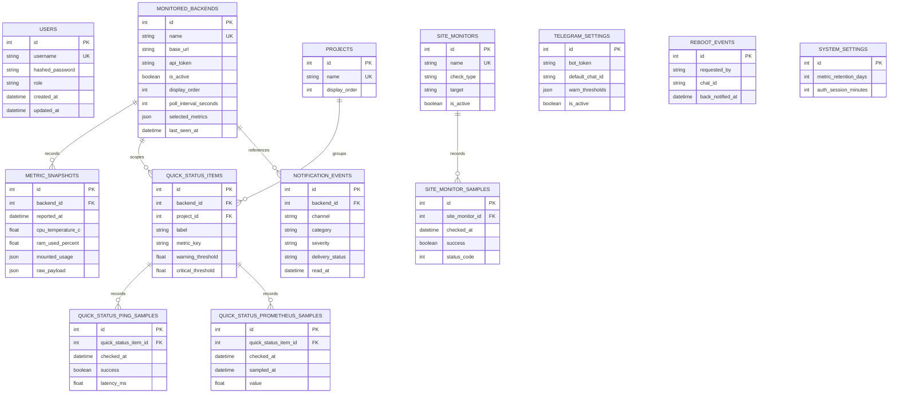

# Database Structure

The backend uses SQLAlchemy models in `backend/app/models/` and creates tables on startup in a single SQLite file (`SERVER_MONITOR_DB_PATH`, WAL journal, `foreign_keys=ON`). The models still carry two logical schemas, `config` (slow-changing configuration) and `history` (high-churn samples), but both map to the same file; the split only documents intent and keeps the migration script's table ordering explicit.

`backend/app/db/schema_compat.py` applies lightweight compatibility migrations on startup (missing columns and indexes). History tables carry composite indexes on `(owner id, timestamp)`, and child rows cascade on delete via `ON DELETE CASCADE`. `site_monitors` mirrors its newest check result in `last_checked_at`, `last_success`, `last_latency_ms`, `last_status_code`, `last_detail` and `consecutive_failures` so neither the poller nor the dashboard needs to rank the samples table. `metric_snapshots.raw_payload` is a deferred column holding only the SSH/Telegram/Wi-Fi/VPN details, top processes and extra disk figures.

## ER Diagram

## Config Database

### `users`

Application login accounts.

| Column | Type | Notes |
| --- | --- | --- |
| `id` | integer | Primary key |
| `username` | varchar(120) | Unique, required |
| `hashed_password` | varchar(255) | Required |
| `role` | varchar(20) | `admin` or `viewer` |
| `created_at`, `updated_at` | datetime | Timestamp mixin |

### `monitored_backends`

Remote monitor agents known to the backend.

| Column | Type | Notes |
| --- | --- | --- |
| `id` | integer | Primary key |
| `name` | varchar(100) | Unique, required |
| `base_url` | varchar(255) | Monitor API URL |
| `api_token` | varchar(128) | Bearer token used when polling the monitor |
| `is_active` | boolean | Enables polling/dashboard use |
| `display_order` | integer | UI ordering |
| `poll_interval_seconds` | integer | Backend poll cadence |
| `notes` | text | Optional admin notes |
| `selected_metrics` | json | UI-selected metrics, mounts, network interfaces |
| `last_seen_at` | datetime | Last successful metric ingest |
| `last_warning` | text | Latest warning summary |
| `created_at`, `updated_at` | datetime | Timestamp mixin |

### `projects`

Dashboard project tabs.

| Column | Type | Notes |
| --- | --- | --- |
| `id` | integer | Primary key |
| `name` | varchar(120) | Unique, required |
| `display_order` | integer | UI ordering |
| `created_at`, `updated_at` | datetime | Timestamp mixin |

### `quick_status_items`

Configures dashboard quick status tiles.

| Column | Type | Notes |
| --- | --- | --- |
| `id` | integer | Primary key |
| `backend_id` | integer | Nullable FK to `monitored_backends.id` |
| `project_id` | integer | Nullable FK to `projects.id` |
| `label` | varchar(120) | Tile label |
| `metric_key` | varchar(64) | Metric/check type |
| `mount_path` | varchar(255) | Optional mount selector |
| `lower_warning_threshold`, `lower_critical_threshold` | float | Optional lower-is-worse thresholds |
| `warning_threshold`, `critical_threshold` | float | Required upper-is-worse thresholds |
| `ping_endpoint` | varchar(255) | Optional ping target |
| `ping_interval_seconds` | integer | Ping cadence |
| `prometheus_url` | varchar(500) | Optional Prometheus endpoint |
| `prometheus_query` | text | Optional instant query |
| `prometheus_interval_seconds` | integer | Prometheus check cadence |
| `prometheus_threshold_direction` | varchar(16) | `higher` or `lower` |
| `display_variant` | varchar(24) | Tile/card rendering mode |
| `display_unit` | varchar(16) | Optional display unit |
| `show_updated_age` | boolean | Shows age in UI |
| `display_order` | integer | UI ordering |
| `last_notified_status` | varchar(16) | Notification state |
| `pending_notification_status` | varchar(16) | Confirmation-window state |
| `pending_notification_due_at` | datetime | Confirmation due time |
| `alert_condition_started_at` | datetime | First observed alert time |
| `created_at`, `updated_at` | datetime | Timestamp mixin |

### `site_monitors`

Admin-managed ping and HTTP site checks.

| Column | Type | Notes |
| --- | --- | --- |
| `id` | integer | Primary key |
| `name` | varchar(120) | Unique, required |
| `check_type` | varchar(16) | Ping or HTTP check type |
| `target` | varchar(500) | Hostname or URL |
| `expected_status_codes` | json | Optional HTTP status whitelist |
| `expected_response_substring` | text | Optional HTTP body check |
| `timeout_ms` | integer | Request timeout |
| `warning_consecutive_failures` | integer | Warning threshold |
| `critical_consecutive_failures` | integer | Critical threshold |
| `check_interval_seconds` | integer | Check cadence |
| `display_order` | integer | UI ordering |
| `is_active` | boolean | Enables checks/dashboard display |
| `created_at`, `updated_at` | datetime | Timestamp mixin |

### `telegram_settings`

Telegram bot and notification settings.

| Column | Type | Notes |
| --- | --- | --- |
| `id` | integer | Primary key |
| `bot_token` | varchar(120) | Optional, masked in API responses |
| `default_chat_id` | varchar(120) | Optional default delivery target |
| `warn_thresholds` | json | Warning thresholds |
| `notification_batch_window_seconds` | integer | Batch window |
| `notification_cooldown_minutes` | integer | Notification cooldown |
| `quick_status_alert_confirmation_minutes` | integer | Confirmation window |
| `quick_status_last_notification_at` | datetime | Last quick-status notification |
| `is_active` | boolean | Enables Telegram settings |
| `created_at`, `updated_at` | datetime | Timestamp mixin |

### `notification_events`

In-app notification center and Telegram delivery audit trail.

| Column | Type | Notes |
| --- | --- | --- |
| `id` | integer | Primary key |
| `channel` | varchar(32) | Example: `telegram` |
| `category` | varchar(64) | Notification category |
| `severity` | varchar(16) | `info`, `warn`, `critical`, etc. |
| `title` | varchar(255) | Summary |
| `body` | text | Full body |
| `backend_id` | integer | Nullable FK to `monitored_backends.id` |
| `backend_name` | varchar(100) | Denormalized display name |
| `delivery_status` | varchar(16) | Delivery state |
| `target` | varchar(120) | Delivery target |
| `error_message` | text | Delivery error |
| `read_at` | datetime | In-app read state |
| `created_at`, `updated_at` | datetime | Timestamp mixin |

### `reboot_events`

Host reboot requests initiated by admin UI or Telegram.

| Column | Type | Notes |
| --- | --- | --- |
| `id` | integer | Primary key |
| `requested_by` | varchar(120) | Actor identifier |
| `chat_id` | varchar(120) | Optional Telegram chat |
| `note` | text | Optional reason/note |
| `back_notified_at` | datetime | Recovery notification time |
| `created_at`, `updated_at` | datetime | Timestamp mixin |

### `system_settings`

Global backend settings.

| Column | Type | Notes |
| --- | --- | --- |
| `id` | integer | Primary key |
| `metric_retention_days` | integer | History retention window |
| `auth_session_minutes` | integer | JWT/session duration |
| `created_at`, `updated_at` | datetime | Timestamp mixin |

## History Database

### `metric_snapshots`

High-churn host metric history.

| Column | Type | Notes |
| --- | --- | --- |
| `id` | integer | Primary key |
| `backend_id` | integer | FK to config `monitored_backends.id`, indexed |
| `reported_at` | datetime | Sample time, indexed |
| `cpu_temperature_c` | float | Optional |
| `ram_used_percent` | float | Optional |
| `total_ram_gb` | float | Optional |
| `memory_available_gb` | float | Optional |
| `swap_used_percent` | float | Optional |
| `docker_container_count` | integer | Optional |
| `docker_running_containers` | json | Optional |
| `disk_usage_percent` | float | Optional |
| `mounted_usage` | json | Optional |
| `cpu_load` | json | Optional |
| `backend_version` | varchar(40) | Monitor version |
| `network_counters` | json | Optional |
| `disk_temperatures` | json | Optional |
| `os_version` | varchar(120) | Optional |
| `uptime_seconds` | integer | Optional |
| `warnings` | json | Optional |
| `raw_payload` | json | Original monitor payload |
| `created_at`, `updated_at` | datetime | Timestamp mixin |

### `quick_status_ping_samples`

Persisted quick-status ping history.

| Column | Type | Notes |
| --- | --- | --- |
| `id` | integer | Primary key |
| `quick_status_item_id` | integer | FK to config `quick_status_items.id`, indexed |
| `checked_at` | datetime | Check time, indexed |
| `success` | boolean | Ping result |
| `latency_ms` | float | Optional latency |
| `created_at`, `updated_at` | datetime | Timestamp mixin |

### `quick_status_prometheus_samples`

Persisted quick-status Prometheus query history.

| Column | Type | Notes |
| --- | --- | --- |
| `id` | integer | Primary key |
| `quick_status_item_id` | integer | FK to config `quick_status_items.id`, indexed |
| `checked_at` | datetime | Backend check time, indexed |
| `sampled_at` | datetime | Prometheus sample time |
| `value` | float | Numeric query result |
| `error_message` | text | Query/check error |
| `created_at`, `updated_at` | datetime | Timestamp mixin |

### `site_monitor_samples`

Persisted site monitoring results.

| Column | Type | Notes |
| --- | --- | --- |
| `id` | integer | Primary key |
| `site_monitor_id` | integer | FK to config `site_monitors.id`, indexed |
| `checked_at` | datetime | Check time, indexed |
| `success` | boolean | Check result |
| `latency_ms` | float | Optional latency |
| `status_code` | integer | Optional HTTP status |
| `detail` | text | Failure/detail text |
| `consecutive_failures` | integer | Failure streak at sample time |
| `created_at`, `updated_at` | datetime | Timestamp mixin |

## Relationship Notes

- `monitored_backends` owns `metric_snapshots`; deleting a backend cascades through service logic and ORM relationships.
- `projects` groups `quick_status_items`.
- `quick_status_items` can reference a backend, a project, both, or neither depending on tile type.
- `quick_status_ping_samples` and `quick_status_prometheus_samples` are children of `quick_status_items`.
- `site_monitor_samples` are children of `site_monitors`.
- `notification_events.backend_id` is nullable and uses `ON DELETE SET NULL` in compatibility-created tables.

## Retention

`system_settings.metric_retention_days` controls backend metric retention behavior. The history database is intentionally separated from the config database so restoring only configuration can bring the app back while history can be recreated empty on startup.
